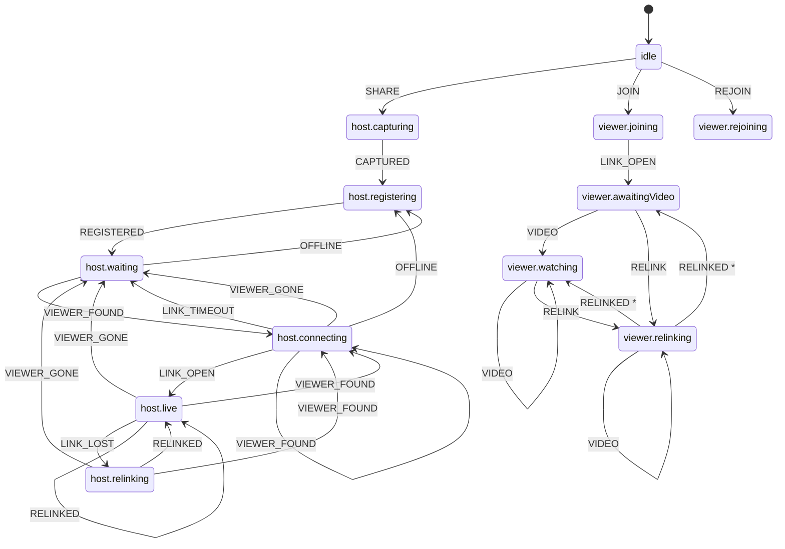
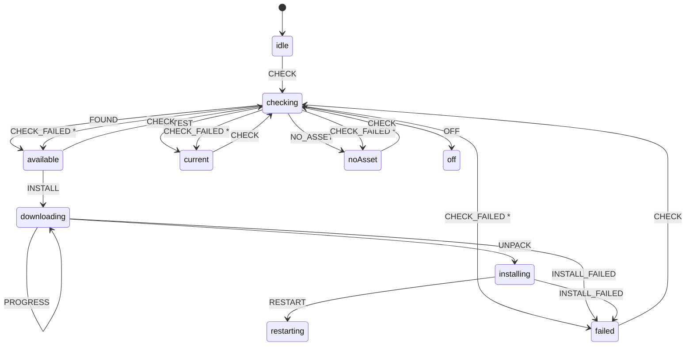
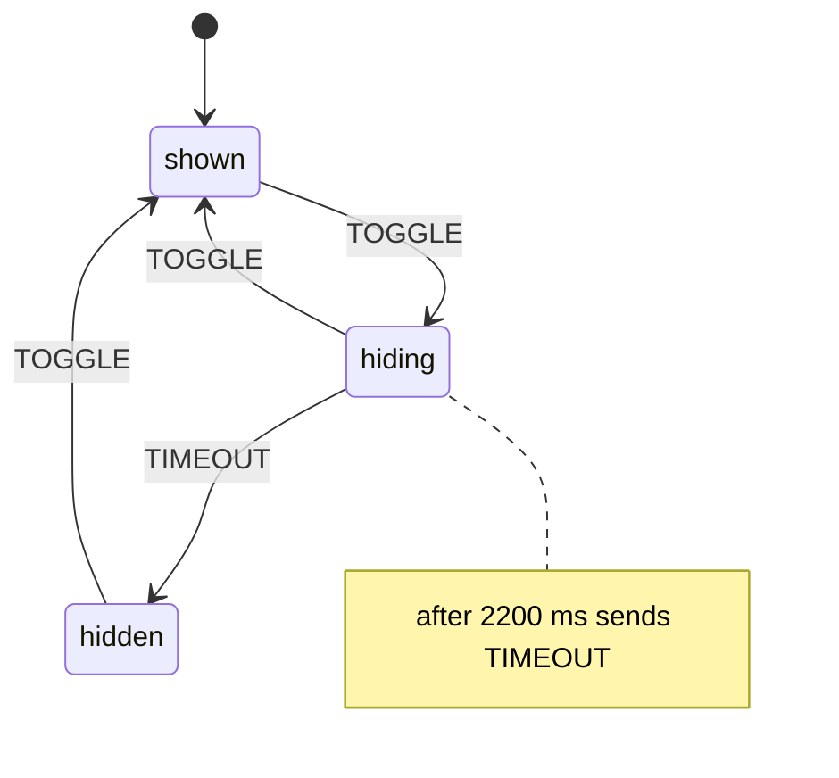

# State machines

<!-- Generated by `npm run machines` from the definitions. Do not edit by hand: CI fails when this file is out of date. -->

Lifecycles in Game Guide are explicit state machines: one named state at a time and a table of allowed moves (`app/renderer/fsm.js`, no dependencies). An event that is not allowed in the current state is ignored and recorded, never half-applied. Timers that belong to a state are cancelled when the state is left.

Every move is logged as `state: <machine> <from> -> <to> (<EVENT>)` and shows in **Copy details** (Connection panel), with each machine's current state and recent moves.

**Rules for changes**

1. A new phase or flag in a lifecycle goes into the definition (a state or an event), not into a new boolean. Then run `npm run machines`.
2. Change the connection objects (`S.conn`, `S.call`, ...) first, then send the event: listeners redraw on the transition and must see the finished change.
3. Session code that awaits something saves `session.epoch` first and returns if it changed.
4. `S.ended`, `S.relinking` and `S.phase` are read-only views of the session machine.

## session

One session on this computer: sharing (host.*) or watching (viewer.*).

- **Lives in:** `app/renderer/session-machine.js`, run by `app/renderer/app.js`
- **Drives:** S.ended, S.relinking, the End button, the "+" invite button, the connection icon; `session.epoch` lets code that awaited something see that the session it worked for has ended.
- **Inspect:** `window.__app.phase`, `window.__app.machines.session.snapshot()`
- **From every state:** `RESET` → `idle`

| State | Meaning | Moves |
|---|---|---|
| `idle` | No session: name, home or join screen. | SHARE → host.capturing JOIN → viewer.joining REJOIN → viewer.rejoining |
| `host.capturing` | Source picked; starting the screen capture. | CAPTURED → host.registering |
| `host.registering` | Getting a code from the pairing service (keeps retrying while offline). | REGISTERED → host.waiting |
| `host.waiting` | Code shown; waiting for a friend to enter it. | VIEWER_FOUND → host.connecting OFFLINE → host.registering |
| `host.connecting` | A friend found the code; opening the drawing link. | LINK_OPEN → host.live VIEWER_FOUND → host.connecting LINK_TIMEOUT → host.waiting VIEWER_GONE → host.waiting OFFLINE → host.registering |
| `host.live` | Friend is watching and can draw. | LINK_LOST → host.relinking RELINKED → host.live VIEWER_FOUND → host.connecting VIEWER_GONE → host.waiting |
| `host.relinking` | Drawing link dropped; video stays up while the friend rebuilds it (up to 20 s). | RELINKED → host.live VIEWER_FOUND → host.connecting VIEWER_GONE → host.waiting |
| `viewer.joining` | Looking up the code and opening the drawing link. | LINK_OPEN → viewer.awaitingVideo |
| `viewer.awaitingVideo` | Drawing link open; waiting for the video. | VIDEO → viewer.watching RELINK → viewer.relinking |
| `viewer.watching` | Video playing; marks go to the player. | VIDEO → viewer.watching RELINK → viewer.relinking |
| `viewer.relinking` | Drawing link dropped; rebuilding it while the video keeps playing. | RELINK → viewer.relinking VIDEO → viewer.relinking RELINKED → viewer.watching (if …) RELINKED → viewer.awaitingVideo |
| `viewer.rejoining` | Waiting a moment, then joining again with the same code (video stayed down, or the player is updating). | (only the moves allowed from every state) |

## update

Self-update through GitHub Releases (check, download, unpack, restart).

- **Lives in:** `app/machines.js`, run by `app/main.js` (updates section)
- **Drives:** Every status sent to the page carries `state`; the update bar is drawn from it. Checks never run during an install, one install at a time.
- **Inspect:** `await window.bridge.state()` (page), `global.__gg.machines.update` (main)

| State | Meaning | Moves |
|---|---|---|
| `idle` | Not checked yet (first check runs a few seconds after launch). | CHECK → checking |
| `checking` | Asking GitHub for the latest release. | FOUND → available LATEST → current NO_ASSET → noAsset OFF → off CHECK_FAILED → available (if …) CHECK_FAILED → current (if …) CHECK_FAILED → noAsset (if …) CHECK_FAILED → failed |
| `off` | Updates are off in this build (running from source, or no GitHub repo set). | (none: final) |
| `current` | Up to date. | CHECK → checking |
| `available` | A newer version is ready to install. | CHECK → checking INSTALL → downloading |
| `noAsset` | A newer version exists, but not for this computer yet. | CHECK → checking |
| `failed` | The last check or install failed (the next check tries again). | CHECK → checking |
| `downloading` | Downloading the new version. | PROGRESS → downloading UNPACK → installing INSTALL_FAILED → failed |
| `installing` | Unpacking the new version. | RESTART → restarting INSTALL_FAILED → failed |
| `restarting` | The helper swaps the files and relaunches; this app exits. | (none: final) |

## drawings

Player's hotkey (Ctrl/Cmd+Shift+H) that hides or shows the friend's marks on the game.

- **Lives in:** `app/machines.js`, run by `app/main.js` (hotkeys)
- **Drives:** Whether the overlay may show marks, the "hidden" receipt sent to the friend, and the page's "Drawings hidden" pill.
- **Inspect:** `await window.bridge.state()` (page), `global.__gg.machines.drawings`, `global.__gg.toggleDrawings()` (main)
- **From every state:** `RESET` → `shown`

| State | Meaning | Moves |
|---|---|---|
| `shown` | Marks appear on the game. | TOGGLE → hiding |
| `hiding` | "Drawings hidden" toast is on screen; marks hide when it ends. | TOGGLE → shown TIMEOUT → hidden after 2200 ms: TIMEOUT |
| `hidden` | Marks are hidden until the hotkey is pressed again. | TOGGLE → shown |

## Implicit state kept on purpose

Found in the same review. These look like state but are counters, observations or single values, so they stay plain variables.

| What | Where | Why it is not a machine |
|---|---|---|
| Overlay presence | `app/main.js`: `overlayWin`, `target`, `overlayActive` | Each is set in one place and `track()` derives what to do from them every tick. A machine would add code, not safety. |
| Window tracking | `app/main.js`: `lastTrackState` | An observation recomputed every 200 to 1500 ms (tracking, background, minimized, away, closed, screen, untracked), not a lifecycle. Sent to the page as-is. |
| Invite link hand-off | `app/main.js`: `pendingInvite` | A one-slot queue held until the page has loaded. |
| Marks on a canvas | `app/renderer/marks.js`: `active` | Derived from what is on the canvas; nothing is stored. |
| Overlay page | `app/renderer/overlay.js`: `toastOn` + `marks.active` | Derived and reported to main, which owns the decision. |
| Video recovery throttles | `app/renderer/app.js`: `lastVideoRestart`, `lastRestart`, `S.netCapMbps`, `S.codecOverride`, `S.encoderStalls`, `S.swFixes` | Rate limits and counters, not phases. They now reset with every session (`teardown()`). |
| Stream problem banner | `app/renderer/app.js`: `issue` | Self-contained 10 s show / 10 s hold hysteresis. |
| Pointer gesture | `app/renderer/app.js`: `drawState.active`, `arrow`, `pan`, `laserOn` | One gesture at a time by construction of the pointer events; lives for one drag. |
| Menus, picker mode, welcome slides, preview | `app/renderer/app.js`: `menus`, `pickerMode`, `slide`, `previewOff` | Single values with no illegal combinations (one menu open is enforced by `closeMenus()`; the preview is derived from focus + the setting). |
| Join/connect watchdogs | `app/renderer/app.js`: `later()` timers | Already session-scoped: `teardown()` clears them. |
